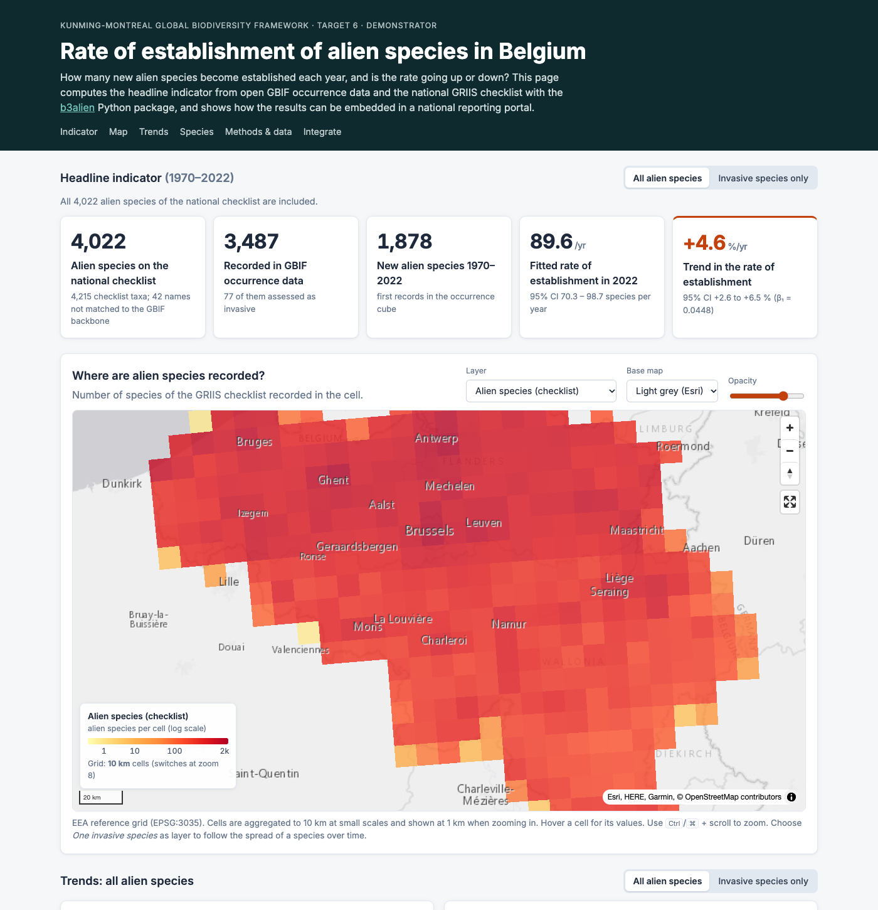

# GBF Target 6 indicator portal: demonstrator for Belgium

A standalone web page that shows the **rate of establishment of alien species** (Kunming-Montreal
Global Biodiversity Framework, Target 6) for Belgium. It is computed with the
[b3alien](https://github.com/mtrekels/b3alien) Python package from a GBIF occurrence cube and the
national GRIIS checklist.

The page is meant as an example of how the indicator can be integrated in a **national reporting
portal**. It is fully static (HTML, JavaScript and a few JSON files), so it can be hosted anywhere,
embedded component by component, or used as a data source for a portal's own charts and maps.



## What the page shows

- **Headline indicators**: alien species on the checklist, species recorded in GBIF, new species in
  the analysis window, the fitted rate of establishment and its trend (with 95% confidence intervals).
  A switch shows the indicator for **all alien species** or only for the species **assessed as invasive**
  in the Belgian checklist (national degree of establishment "invasive" or "widespread invasive").
- **Interactive map** on the EEA reference grid, with a choice of base maps: alien and invasive species
  richness and occurrences, total species richness and sampling effort. The grid is shown at
  10 km when zoomed out and at 1 km when zoomed in. The current view is kept in the URL
  (`#zoom/lat/lon`) so it can be shared.
- **Single invasive species**: the cells where one invasive species was recorded, coloured by number of
  occurrences or by year of first record, with a time slider (and play button) to follow its spread.
- **Zoomable charts**: cumulative discoveries with the Solow-Costello model, new species per year with
  the fitted rate of establishment, and sampling effort over time. Each chart can be exported as PNG.
- **Species table**: searchable and sortable, with filters on invasiveness and habitat, and CSV export.
- **Methods, data citations and embed snippets.**

## How it works

```
GBIF occurrence cube (EEA grid, CSV/zip) ─┐
                                          ├─► pipeline/build_data.py (b3alien) ─► site/data/*.json ─► site/ (static web page)
GRIIS checklist (ColDP, ChecklistBank)  ──┘
```

1. **Pipeline (Python, run once per data update).** `pipeline/build_data.py` runs the b3alien workflow:
   it matches the checklist to the GBIF taxonomic backbone, loads the cube, computes the discoveries,
   fits the Solow-Costello model with bootstrap confidence intervals, and aggregates the grid layers.
   The results are written as compact JSON files to `site/data/`.
2. **Web page (no server-side code).** `site/index.html` reads the JSON files. The map uses
   [MapLibre GL JS](https://maplibre.org/), the charts [Plotly](https://plotly.com/javascript/).
   Grid cells are stored only as EEA cell coordinates (`e`, `n`); the browser rebuilds the squares and
   reprojects them from EPSG:3035 with [proj4js](https://github.com/proj4js/proj4js). No GIS files,
   map server or database are needed.

## Run locally

The site must be served over HTTP (browsers block `fetch` from `file://`):

```bash
cd site
python -m http.server 8000
# open http://localhost:8000
```

## Rebuild the data (other country or newer download)

1. Generate a GBIF occurrence cube on the **EEA reference grid** (see the
   [b3alien documentation](https://b3alien.readthedocs.io/), Appendix A) and download it as CSV/zip.
2. Download the national GRIIS checklist in **ColDP** format from [ChecklistBank](https://www.checklistbank.org).
3. Run the pipeline (Python 3.10+):

```bash
pip install -r pipeline/requirements.txt
python pipeline/build_data.py \
    --cube EEA_BE_data_cube.zip \
    --checklist GRIIS_BE_ColDP.zip \
    --region "Belgium" \
    --cube-doi 10.15468/dl.5nw2hy \
    --start 1970 --end 2022
```

| Option | Description |
|---|---|
| `--cube` | GBIF cube on the EEA grid (CSV or zip) |
| `--checklist` | GRIIS checklist in ColDP format (zip) |
| `--region` | Name shown on the page |
| `--cube-doi` | DOI of the GBIF download, used for the citation and licence |
| `--start`, `--end` | Analysis window for the rate of establishment (default 1970–2022) |
| `--bootstrap` | Bootstrap iterations for the confidence intervals (default 200) |
| `--rematch` | Redo the taxon matching (cached in `pipeline/work/`) |

The run takes a few minutes for a national 1 km cube (Belgium: 18.9 million cube records, about
4–5 minutes and 8 GB of memory). The taxon matching calls the GBIF API. The bootstrap is random, so confidence
intervals vary slightly between runs.

## Integrate in a portal

### 1. Embed components with an iframe

Every block of the page can be shown on its own with the `embed` URL parameter:

Add `subset=invasive` to show the indicator cards and trend charts for the invasive species only.

| `embed=` | Component |
|---|---|
| `indicators` | Headline indicator cards |
| `map` | Interactive map (also accepts `layer=` and `basemap=`) |
| `cumulative` | Cumulative discoveries and model fit |
| `annual` | New species per year and fitted rate of establishment |
| `effort` | Sampling effort over time |
| `species` | Species table |

Map layers: `alien_richness`, `alien_occurrences`, `invasive_richness`, `invasive_occurrences`,
`richness`, `observers`, `occurrences`, and `species` for one invasive species
(`&species=<GBIF key>`, optional `&color=year` and `&year=<last year shown>`).
Base maps: `light`, `osm`, `satellite`. A map view can be fixed with the URL hash
(`#zoom/latitude/longitude`).

```html
<iframe src="https://<host>/index.html?embed=map&layer=alien_richness#7/39.6/-8.0"
        width="100%" height="520" style="border:0" loading="lazy"
        title="Alien species per grid cell"></iframe>
```

### 2. Use the data files

The JSON files in `site/data/` can be consumed directly by a portal's own components:

| File | Content |
|---|---|
| `summary.json` | Headline indicators per subset (`indicators.all`, `indicators.invasive`), analysis window, data sources with citations and licences |
| `timeseries.json` | Sampling effort, and per subset (`subsets.all`, `subsets.invasive`): years, discoveries, cumulative counts, model fit, bootstrap intervals |
| `species.json` | One record per checklist taxon: name, GBIF key, invasive, habitat, first record, cells, occurrences |
| `grid_10km.json`, `grid_1km.json` | Grid layers: `rows` of `[e, n, alien_richness, alien_occurrences, invasive_richness, invasive_occurrences, richness, occurrences, observers]` |
| `invasive_species_cells.json` | Per invasive species (by GBIF key): `rows` of `[e, n, occurrences, first_year]` on the 1 km grid |

A grid cell's lower-left corner is `(e × resolution, n × resolution)` in EPSG:3035, which corresponds to
the EEA cell code `<resolution>E<e>N<n>` (e.g. `1kmE2639N1762`). `site/js/eea.js` shows how to turn the
rows into GeoJSON.

### 3. Host the page

Copy the `site/` folder to any static web server, or use the included GitHub Pages workflow
(`.github/workflows/pages.yml`: enable Pages with "GitHub Actions" as the source). There is no build step.

## Data and licences

- **Occurrence data**: GBIF.org (25 November 2026) GBIF Occurrence Download
  https://doi.org/10.15468/dl.5nw2hy, licensed under
  [CC BY-NC 4.0](https://creativecommons.org/licenses/by-nc/4.0/). The aggregated files in `site/data/`
  are derived from this download and fall under the same licence: cite the download and do not use
  them commercially.
- **Checklist**: Desmet P., Reyserhove L., Oldoni D. et al. (2025). Global Register of Introduced and
  Invasive Species – Belgium. Version 2025-12-29. https://doi.org/10.48580/d36yl (CC BY 4.0)
- **Base maps**: Esri (Light Gray Canvas, World Imagery) and OpenStreetMap tiles, used under their
  providers' terms with attribution. A production portal should use its own or a national base map
  service; the OpenStreetMap tile servers are not intended for heavy traffic.
- **Code**: MIT licence (see `LICENSE`).

## Invasive species

The checklist assesses invasiveness per area in the `degreeOfEstablishment` of its Distribution records.
The pipeline uses the **national** (Belgium) records: a taxon counts as invasive when its national degree of
establishment is "invasive" or "widespread invasive" (77 taxa). Species that are invasive in only one of
the regions (Flanders, Wallonia, Brussels) are not included. A checklist that instead flags species with
`isInvasive` in its species profile is supported by the same pipeline.

With few invasive discoveries per year, the bootstrap intervals of the invasive subset are wide and can
change noticeably between runs.

## Caveats

GBIF records reflect where and when people observed, not the true distribution of species. Absence of
records is not evidence of absence, and the year of the first GBIF record lags behind the actual
introduction. Interpret the discoveries together with the sampling effort.

## Repository layout

```
pipeline/            Python pipeline (b3alien) that produces the data files
  build_data.py
  requirements.txt
site/                Static web page
  index.html
  css/style.css
  js/app.js          page logic, embed mode
  js/map.js          MapLibre map, layers, legend
  js/eea.js          EEA cell codes to GeoJSON (EPSG:3035 to WGS84)
  js/charts.js       Plotly charts
  js/species.js      species table
  data/              generated JSON files
docs/screenshot.png
```
